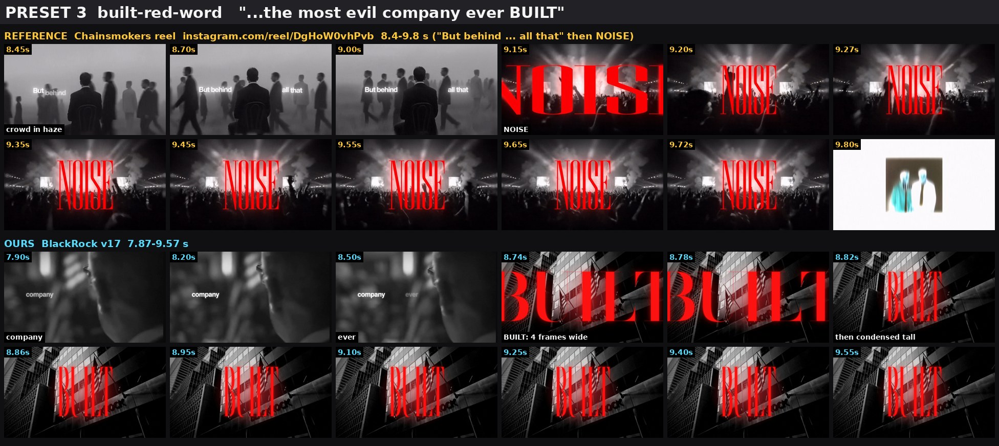

# built-red-word

Say "apply preset built-red-word". Use it for one hard word at the end of a line, here BUILT in "...the most evil company ever BUILT". The user calls it "the belt one", where the word comes with the red effect.

## Reference

Chainsmokers reel: https://www.instagram.com/reel/DgHoW0vhPvb/

- **8.4–9.1 s, "But behind ... all that":** a black-and-white crowd in a haze, with small words at the sides.
- **9.13–9.8 s, "NOISE":** a tall, condensed red serif word with a red glow over a dark black-and-white concert crowd. Its first two frames are stretched wide, then it is condensed.

## In our film

BlackRock v17 at 7.87–9.57 s: "company ever BUILT". The word BUILT lands at 8.73 s.

## Frame by frame (60 fps)

**"company ever" (7.87 → 8.73 s):**
- The shot is the person seen from behind, facing the crowd. It is black and white, only lightly lifted (×0.95 + 16), with vignette 0.25 and grain 2.5, and pushes slowly from 1.10 to 1.12.
- "company" and "ever" are small bold sans (TeX Gyre Heros Bold, 78 px, white with a soft white glow) at the sides, x 22 % and 47 %, y 502.
- Each word fades in from a 5 px blur over 3 frames on its onset.

**BUILT (8.73 s to the cut at 9.57 s):**
- **The shot:** a dark black-and-white picture (the company's tower) with contrast ×1.2, pulled down, vignette 0.45 and grain 5.
- **A red light behind the word:** a radial glow in screen blend, an ellipse 30 % × 48 %, `rgba(255,60,70,0.60)` fading to nothing at 80 %.
- **The word:** BUILT in Bodoni Moda 600, 777 px, `#ff1414`, with a red glow (text-shadow at 18, 60 and 140 px), centred.
  - Stretched wide (`scaleX 0.95`) for 4 frames, which is the reel's 2 frames.
  - Then condensed tall (`scaleX 0.28`) and held to the cut.

## The user's notes that shaped it

- The red scene stays as v6 had it ("the original v6 red scene").
- "company ever built" comes after it.
- For the shot behind "company ever": "less texture, less opacity, so he can be seen".

## Build it

Run `recipe.py`. Its steps are:

1. `prep_v10.r_company2`: the shot behind "company ever", written to `assets/clips/v15_company.mp4`.
2. `prep_v10.r_built`: the dark shot behind BUILT, written to `assets/clips/v10_built.mp4`.
3. `build.s_hook`: the scene, written to `compositions/s_hook.html`.
   - The BUILT part is the block under the comment `"built.": its NOISE`: `v10_built.mp4`, the `.rglow` layer, the `.noise` word and its two `scaleX` sets.
   - `HOOK_CSS` holds `.sw` (the side words), `.noise` and `.rglow`.
   - The rest of `s_hook` is other moments of the film.

## Inputs a new edit swaps

- **Shots:** `r_company2` uses `SRC["FG"]` at 2.55 s (the shot behind the side words). `r_built` uses `SRC["XEX"]` at 111.2 s (the dark shot behind the word).
- **Words and times:** the side words and the big word are in `s_hook()`. The times are `T["company"]`, `T["ever0"]`, `T["built"]`, with the span `B["built"]`.
- **Font:** `assets/fonts/BodoniModa-96-600.ttf` (the `Bodoni` face in `FONTS`).
