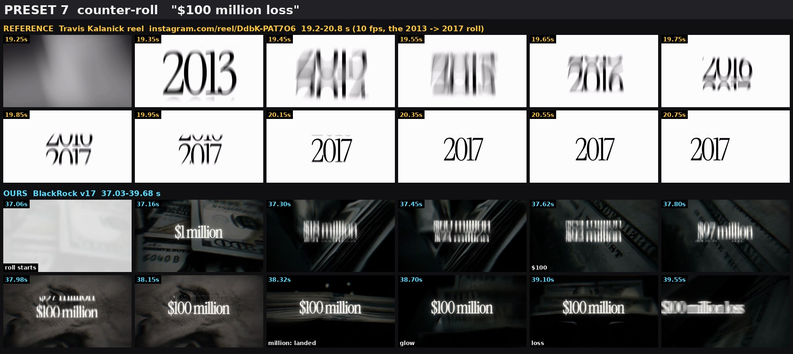

# counter-roll

Say "apply preset counter-roll". Use it for a figure that rolls up and lands, here "$100 million loss".

## Reference

Travis Kalanick reel: https://www.instagram.com/reel/DdbK-PAT7O6/ at 19.2–20.8 s (10 fps). The year rolls from 2013 to 2017:
- The digits stream upward with a vertical motion smear.
- They slow into place, easing out.
- The type is black serif on white.

## In our film

BlackRock v17 at 37.03–39.68 s: "cost him $100 million loss".
- The roll starts on "cost".
- It lands on "million" (38.27 s).
- "loss" joins on its word (39.05 s).
- It cuts on "That" (39.68 s).

## Frame by frame (60 fps)

**Steps:** everything moves on 12 fps steps (5 frames each), as the reel does.

**Step 1:** the reel's soft white frame (the background blurred, ×0.25 + 205).

**Steps 2–3:** "$1 million" sharp.

**The roll:**
- Values: `$1 → $7 → $18 → $31 → $46 → $60 → $73 → $84 → $92 → $97 → $100`, each as "… million" in Instrument Serif 250 px (tracking −0.045). The line is centred, with its centre at y 470.
- Each value is one line, and one line step is 1.08 × the type size.
- The position follows an ease-out cubic from step 3 to the "million" onset.
- Only a band of ±0.62 lines around the centre shows, with soft 18 px edges.
- The vertical smear is speed × line × 0.9, at most 140 px, so it is fast and blurred first, then slows and sharpens.

**"loss":** on its word, the line re-centres as "$100 million loss" and "loss" blooms in, blurred 7 px for one step with a stronger glow.

**Out:** the last two steps slide left, −340 px and then −980 px, with a 60 px horizontal smear.

**Glow (white only):**
- Three blurs of the type (5, 18 and 52 px) are added as a halo, capped at 0.9.
- The type itself is `#FAF7F0`.
- The bloom widens them on the "loss" step.

**Background:**
- Money footage at 12 fps, 65 % colour and 35 % grey, at half brightness.
- Fine screen lines, vignette 0.40 and grain 4.

## The user's notes that shaped it

- "$100 million. There can be a glow effect on it." This gave the stronger white glow (`glow_white2`).
- "remove any full stop or commas". So the line is "$100 million loss" with no full stop.

## Build it

Run `recipe.py`. Its one step, `prep_v17.r_count3`, sets the text and glow and runs `prep_v10.r_count`, which writes `assets/clips/v17_count.mp4`. In the HyperFrames scene (`s_bet`), the clip is placed from "cost" to the next cut.

## Inputs a new edit swaps

All in `lib/prep_v10.py` unless noted:
- `COUNT_VALUES`: the values the roll passes through.
- `LOSS_TEXT`: the word that joins at the end, set in `r_count3`.
- `ISF`: the font, at 250 px.
- `SRC["COPP"]`: the background footage.
- Times: `RT("cost")` (start), rest-recording word 48 "million" (lands), 49 "loss" (joins) and 50 "That" (the cut).
