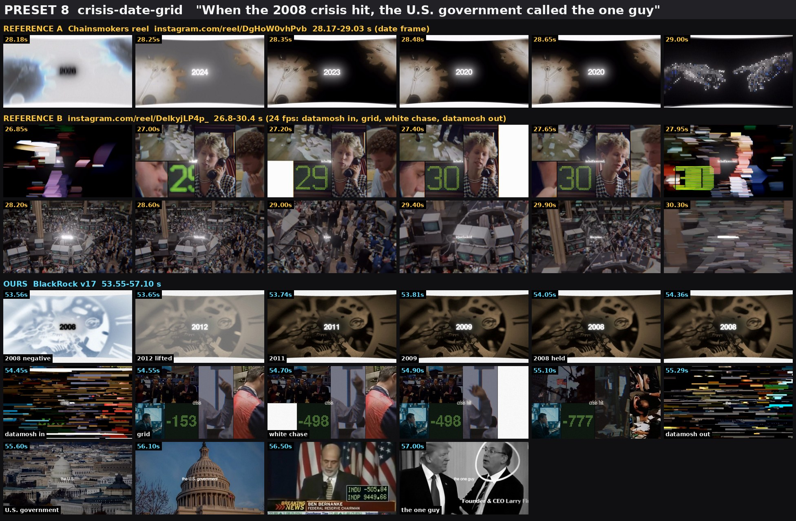

# crisis-date-grid

Say "apply preset crisis-date-grid". Use it for a year that sets the scene, then a burst of footage, here "When the 2008 crisis hit, the U.S. government called the one guy".

## References

**A, the year frame.** Chainsmokers reel https://www.instagram.com/reel/DgHoW0vhPvb/ at 28.17–29.03 s.
- A clock in a curved white frame.
- The years count down (2026 → 2024 → 2023 → 2020) in white with a glow.
- The first frame is a negative.

**B, the grid.** https://www.instagram.com/reel/DelkyjLP4p_/ at 26.8–30.4 s (24 fps).
- A glitch smear (datamosh) leads into a 5-tile grid that includes a green LED scoreboard tile ("29", "30").
- A white light jumps from tile to tile.
- A datamosh leads out into the trading floor shots.

## In our film

BlackRock v17 at 53.55–57.10 s:

| Time | Part |
|---|---|
| 53.55–54.43 s | The year frame ("When the 2008") |
| 54.43–55.27 s | The grid ("crisis hit") |
| 55.27–57.10 s | The shots for "the U.S. government called the one guy" |

## Frame by frame (60 fps)

**The year frame (53 frames):**
- **The picture:** 8 frames of a clock with moving gears, slowed across the whole span by blending between frames, and pushed 1.0 → 1.045.
- **Grade:** sepia (×1.10 / 0.93 / 0.72 plus a little warmth). The centre is darkened by a soft ellipse so the year reads. Concave lens 0.20, blur 1.3, vignette 0.30, grain 4.
- **Curved white frame:** white (244) above and below the picture, as the reel's frame does. The picture's top edge sits at 60 px at the sides and curves down to 87 px in the middle. Its bottom edge sits at 1023 px at the sides and curves up to 993 px in the middle.
- **The year:** TeX Gyre Heros Bold 112 px, centred at y 545, with a white glow:

  | Frames | Year |
  |---|---|
  | 0–3 | **2008** as a negative (inverted, blurred) |
  | 4–9 | **2012** lifted grey |
  | 10–13 | **2011** |
  | 14–17 | **2009** |
  | 18 on | **2008**, held |

**The grid (50 frames):**
- **In:** a 5-frame datamosh from the year frame's last frame. Bands of the two pictures are dragged sideways into streaks, with black gaps, and more and more of the new picture shows.
- **Tiles** (gaps 4 px, black):

  | Tile | Box (x0, y0, x1, y1) | Content |
  |---|---|---|
  | TL | 0, 0, 938, 548 | Footage |
  | BL | 0, 552, 438, 1080 | Footage |
  | LED | 442, 552, 938, 1080 | Scoreboard |
  | C | 942, 0, 1458, 1080 | Footage at ×0.70 brightness (the caption sits over it) |
  | R | 1462, 0, 1920, 1080 | Footage at ×0.82 brightness |

- **LED tile:** green dot-matrix (pitch 12 px, dots 3.7 px) with glowing digits. It shows "-153", then "-498" at frame 9, then "-777" at frame 31.
- **Swaps:** R changes shot at frame 40 and BL at 42.
- **The white chase:** each tile goes white (250) for 5 frames, in the order TL (frame 9), BL (14), C (19), R (24), LED (29).
- **Out:** a 6-frame datamosh into the next shot. Grain 4.

**After the grid:** the film's own shots for the rest of the line, with the same datamosh over 6 frames at each of their cuts.

**Captions:** the small serif captions ("crisis hit", "the U.S. government", "called", "the one guy") are the film's caption style, not part of this preset.

## The user's notes that shaped it

- "In the 2008 financial crash time, I want the frame to be the 28th second of the Chainsmoker video, where he says the timeline..."
- "https://www.instagram.com/reel/DelkyjLP4p_/ 28th second of this video... for our part ... 'when the 2008 crisis hit, the U.S. government called the one guy.'"
- On the year frame: "this can be more animated... video can be played in side of it". So the clock plays and pushes instead of being a still.

## Build it

Run `recipe.py`. Its steps are:

1. `prep_v17.r_date2`: the year frame, written to `assets/clips/v17_date.mp4`.
2. `prep_v17.r_grid2`, which runs `prep_v16.r_grid`: the grid, written to `assets/clips/v17_grid.mp4`.
3. `prep_v16.r_gov`: the following shots with a datamosh at their cuts, written to `assets/clips/v16_gov.mp4`.
4. `build.s_crisis`: places the three clips, written to `compositions/s_crisis.html`.

## Inputs a new edit swaps

**Year frame:** `S16["QC"]` at 8.38 s (the clock), and the years and their frame counts in `r_date2()`.

**Grid:** in `lib/prep_v16.py`:
- `TILES`: the layout.
- `GRID_SHOTS`: each tile's source, second, crop centre and zoom.
- `GRID_SWAP`, `GRID_WHITE` (the chase order and frames) and `LED_VALUES`.
- Sources come from the `S16` dict.

**After:** the base cut `assets/clips/v6_rest2.mp4`. Its shots get the datamosh at the cuts `r_gov` finds.

**Times:** rest-recording words 94 "When" (in), 97 "crisis" (the grid), 99 "the" of "the U.S." (out of the grid) and 106 "Wall" (the next cut).
