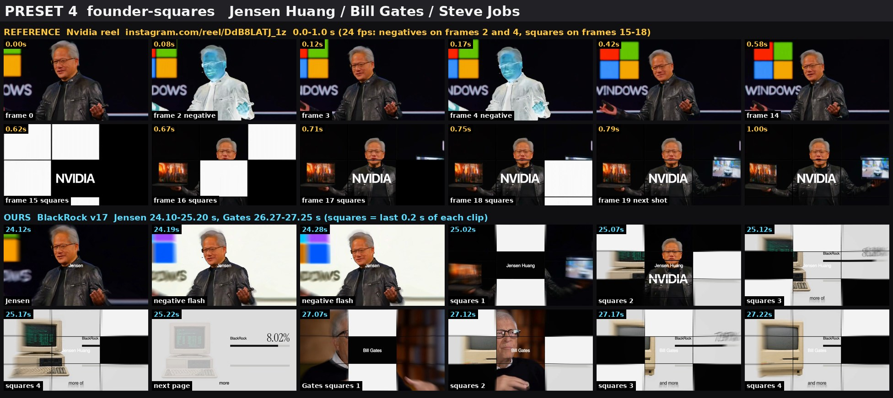

# founder-squares

Say "apply preset founder-squares". Use it as a transition out of a person's clip into the next shot, here Jensen Huang → Microsoft page, Bill Gates → Apple page, Steve Jobs → Elon on Rogan.

## Reference

Nvidia reel: https://www.instagram.com/reel/DdB8LATJ_1z/ at 0.0–1.0 s (24 fps).

- Jensen on stage. Frames 2 and 4 are negatives (inverted colours).
- Frames 15–18 are the squares: a 3 × 3 grid of white, black and next-shot squares that turns into the next shot (NVIDIA on stage).

## In our film

BlackRock v17:

| Clip | On screen | Squares |
|---|---|---|
| Jensen | 24.10–25.20 s | 25.00–25.20 s |
| Gates | 26.27–27.25 s | 27.05–27.25 s |
| Jobs | 28.25–29.63 s | 29.43–29.63 s |

Jensen's clip is the reel's own opening (frames 0–21), so it also carries the reel's own squares in its middle (24.73–24.90 s) before ours at the end.

## Frame by frame (60 fps)

**Negatives:** frames 2 and 4 of each clip, counted at 24 fps, are the full picture inverted. At 60 fps those are frames 5–7 and 10–12 of the clip.

**The squares (`TILE_SEQ`):** the last 12 frames (0.2 s) of each clip. The frame is a 3 × 3 grid of 640 × 360 cells with 6 px dark gaps (10). There are 4 patterns, 3 frames each, read row by row. C is the current shot, W white (246), B black (6) and N the next shot:

| Frames | Pattern | Row 1 | Row 2 | Row 3 |
|---|---|---|---|---|
| 1–3 | `CWCCBCCWC` | C W C | C B C | C W C |
| 4–6 | `WCBNCWBCN` | W C B | N C W | B C N |
| 7–9 | `NWNBNNWNB` | N W N | B N N | W N B |
| 10–12 | `NNWNNBNNN` | N N W | N N B | N N N |

The next shot then cuts in whole.

**Finish:** a soft blur in the corners (`center_focus`: zoom 0.014, blur 2.4) and no texture.

## The user's notes that shaped it

- "slightly before, on his face ... a transition between the clips". So the squares start 0.2 s before the cut, while his face is still on screen.

## Build it

Run `recipe.py`. Its one step, `prep_v10.r_founders2`, writes `assets/clips/v3_r1_jensen.mp4`, `v3_r1_gates.mp4` and `v3_r1_jobs.mp4`.

The reusable part is `tile_out(name, frames, next_frame)` in `lib/prep_v10.py`:
- Give it any clip's frames and the next shot's first frame.
- It adds the two negatives at the start and the squares over the last 0.2 s.

## Inputs a new edit swaps

- **The clips:** in `r_founders2()`, the Nvidia reel's opening (`blackrock-src/dl/v3/nvidia_reel.mp4`, top 540 px band, sharpened), `bill_gates.mp4` at 9.40 s and `steve_jobs.mp4` at 0.30 s.
- **The next shots:**
  - `blackrock-src/work/next_ms.png` and `next_ap.png` are snapshots of the following pages.
  - The first frame of `assets/clips/v5_rogan.mp4` is the shot after Jobs.
- **Times:** `founder_slots()` uses the word times `T["it"]`, `T["jensen"]`, `T["more2"]`, `T["bill"]`, `T["and"]`, `T["steve"]` and `OPEN_END`.
