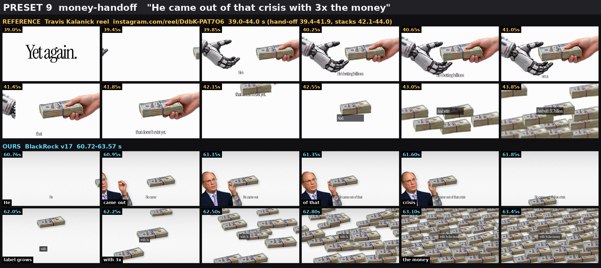

# money-handoff

Say "apply preset money-handoff". Use it for money changing hands and piling up, here "He came out of that crisis with 3x the money".

## Reference

Travis Kalanick reel: https://www.instagram.com/reel/DdbK-PAT7O6/ at 39.0–44.0 s.

- **39.4–41.9 s, the hand-off:** on white, a robot hand reaches for a cash stack held out by a human hand. A small dark caption builds at the bottom ("He's betting billions on a ... that doesn't exist yet.").
- **42.1–44.0 s, the stacks:** cash stacks fall onto the white page while a grey label grows with its words ("And with $1.7 billion").
- **The flashes:** the reel's white flashes ("Following years of controversy", 22.3 and 22.9 s) are used for the cut out.

## In our film

BlackRock v17 at 60.72–63.57 s:
- The hand-off runs to "with" (61.87 s).
- The stacks and label run to the cut into "Today" (63.57 s).

## Frame by frame (60 fps, on 12 fps steps)

**Page:** white, with a soft grey shade at the top and bottom.

**The hand-off (69 frames):**
- The person's cut-out (scaled 0.70) slides in from the left: 760 px with an ease-out cubic over 0.45 s, to x −290, then drifts 20 px. It has a soft shadow.
- The cash stack (the user's money image, 560 px wide) slides in from the right the same way (1250 px) to its place by his hand (left edge x 575, centre y 592), then drifts 40 px left.
- At 0.78 s a wipe clears the person, right to left, over 0.15 s.
- At 0.95 s the cash drops off the bottom, accelerating.
- **Caption:** "He came out of that crisis" builds word by word, centred, at y 905. It is Instrument Serif 80 px in `#222`.

**The stacks (102 frames, 49 stacks):**
- The first stack comes down slowly from the top into the middle (0.40 s).
- The other 48 drop in from 560 px above, each with an ease-out over 0.3 s. They come faster and faster: the j-th lands at 0.48 + 0.78 × (j / 47)^0.62 s (j = 0…47).
- They land in random order across 8 rows that fill the page, each tilted up to ±4°, with shadows.
- The whole pile drifts up 60 px.

**The label "with 3x the money":**
- A grey box (`rgba(58,58,58,0.92)`) 104 px tall, with white Instrument Serif 72 px and 28 px padding.
- Each word turns on at its onset and the box opens over it, left to right (0.2 s, ease-out cubic). The box never comes in whole first.
- The finished line ends centred.
- The box rises with the stacks, one step every 5 frames: y 1000 → 905 → 800 → 700 → 620 → 575 → 560.

**Out:** a white flash (0.82 opacity, one reel frame = 6 frames) on the cut into the next part.

## The user's notes that shaped it

- "same motion graphic of them handing the money ... money image from Pinterest". The image is the user's Drive file https://drive.google.com/file/d/1a05D9eTNUGOwonZ1pAh80EYbvnWrLCjG/view.
- "he came out of that crises should be in centre. and a bit big"
- "3x the money should be a bit more big. and rectangle is coming first full then text is coming instead it should animate with text coming on screen from left to right"
- The flashes: "following years of controversy ... flashes ... I want a similar kind of flashes in my video in this part".

## Build it

Run `recipe.py`. Its steps are:

1. `prep_v17.r_money2`: sets the v17 layout and runs `prep_v16.r_money`, which writes the hand-off and stacks to `assets/clips/v17_money.mp4`.
2. `build.s_money`: the caption, the growing label and the flash, written to `compositions/s_money.html`.

## Inputs a new edit swaps

- **Layout:** `MONEY` (v17: `fink_s 0.70, fink_x −290, cash_w 560, cash_x 575, cash_y 592`), set in `r_money2`.
- **The person's cut-out:** `blackrock-src/dl/v10/larry_new_cut.png`.
- **The money image:** `blackrock-src/dl/v16/money_stack.png` (the user's Pinterest image, 2172 × 724 with transparency, from the Drive link above).
- **The pile:** `stack_layout()` (49 stacks, random seed 1607).
- **Words and times:** the text is in `s_money()`. The times are rest-recording words 119–124 "He came out of that crisis", 125 "with", 126 "3x" (spoken "three times"), 128 "the", 129 "money" and 130 "Today" (the cut).
