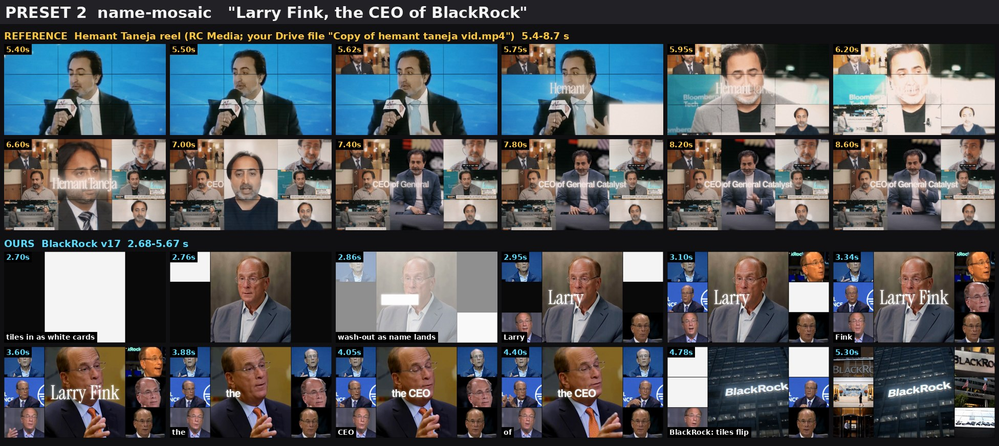

# name-mosaic

Say "apply preset name-mosaic". Use it for the person's name and title ("Larry Fink, the CEO of BlackRock").

## Reference

Hemant Taneja reel (RC Media) at 5.4–8.7 s. There is no Instagram link on file for it, only the user's Drive file "Copy of hemant taneja vid.mp4" (Drive id `1d7GFmviqHaqcKIZt0DwV9cJpLa8aLkEW`, local copy `dimon-src/_drive/`).

- A mosaic takes over the frame: one big tile in the middle and smaller ones down each side.
- Every tile arrives as a white card first and then plays a different clip of him.
- The name "Hemant Taneja" sits over the middle in a serif with a bloom, and the frame washes out as it lands.
- The title "CEO of General Catalyst" builds word by word in a bold grotesque while the tiles keep changing.

## In our film

BlackRock v17 at 2.68–5.67 s: "Larry Fink, the CEO of BlackRock".

## Frame by frame (60 fps, from the scene's first frame)

**Layout:** a centre tile 960 × 1080 at x 480, and three 480 × 360 tiles down each side (x 0 and x 1440). The gaps between tiles are 6 px of near-black (10).

**Tiles arrive every 4 frames** in this order: centre (0), left 1 (4), right 3 (8), left 3 (12), right 1 (16), left 2 (20), right 2 (24).
- Each tile is white (246) for its first 3 frames, then plays its clip, cropped to the person.
- Some tiles change clip later, again white for 3 frames first: the centre at frame 49, right 1 at 62 and right 2 at 88.

**The name lands on "Larry":** the whole frame washes toward white by 0.55, then 0.85, then 0.35, over the two frames before the word and the word's own frame.
- "Larry Fink" is set in Instrument Serif (upright) at 230 px, centred at y 545, with the white glow.
- Each word comes in on its onset with the Dario entrance: blurred and blooming at scale 1.04, sharp and at rest 4 frames later.

**The title replaces the name on "the":** "the CEO of" in the bold grotesque (TeX Gyre Heros Bold) at 124 px, at the same height. Each word cuts in on its onset in its own place; the line is laid out whole first.

**On the company name ("BlackRock"):** every tile flips to the company's footage (buildings, signs), one after another with 0–7 frame delays (centre, L1, R1, L2, R2, L3, R3). Each again starts with 3 white frames.

## Build it

Run `recipe.py`. Its steps are:

1. `prep_v9.r_mosaic`: the mosaic clip, written to `assets/clips/v9_mosaic.mp4`.
2. `build.s_name`: the scene, written to `compositions/s_name.html`. The name and title are HTML text over the clip.

## Inputs a new edit swaps

All in `lib/prep_v9.py`:
- `MOSAIC_RECTS`: the layout.
- `MOSAIC_FINK`: each tile's clips of the person, as (start frame, source, second, crop centre x/y, crop width).
- `MOSAIC_BR`: the company footage each tile flips to, as (delay, source, second, crop).
- `SRCS`: the sources.

The words and times are the text in `s_name()` and the times `T["larry"]`, `T["fink"]`, `T["the2"]`, `T["ceo"]`, `T["of0"]`, `T["blackrock"]`, with the scene span `B["name"]`.
