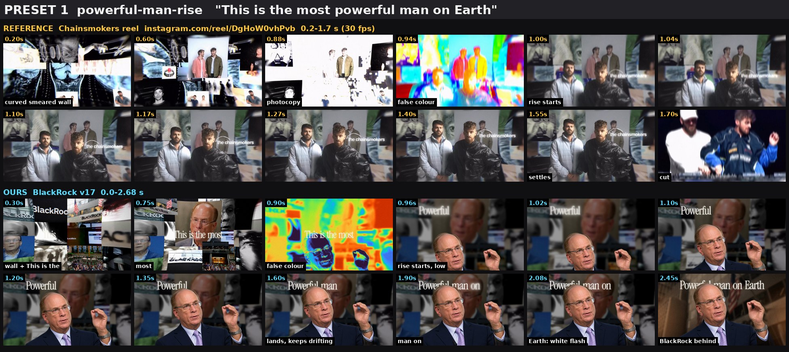

# powerful-man-rise

Say "apply preset powerful-man-rise". Use it for the opening line that introduces the person ("This is the most powerful man on Earth").

## Reference

Chainsmokers reel: https://www.instagram.com/reel/DgHoW0vhPvb/ at 0.2–1.7 s (30 fps).

| Time | What happens |
|---|---|
| 0.2–0.85 s | A curved, smeared wall of photos |
| ≈0.88 s | One photocopy frame (hard black and white) |
| 0.93–0.97 s | Two false-colour frames (rainbow heat-map colours) |
| 1.0–1.63 s | The duo rises from the bottom over the wall, in steps, easing out |
| 1.7 s | Straight cut |

## In our film

BlackRock v17 (`blackrock-open/renders/blackrock_v17_full_60fps.mp4`) at 0.00–2.68 s, the line "This is the most powerful man on Earth".

## Frame by frame (60 fps)

The person appears at 0.95 s (frame 57, two frames before "powerful").

**The wall (frames 0–56, one pre-rendered clip):**

| Frames | What happens |
|---|---|
| 0–5 | The smeared pan: the first wall state smeared sideways (140 px box blur) and bent so the rows bow out 22 % at the edges. Red and blue channels split ±16 px, saturation ×1.9, contrast ×1.35, highlights bloom. |
| 6–9 | The same wall grey and soft. |
| 10–48 | The wall builds on 12 fps steps (5 frames each). 12 photos fill a 4 × 3 grid (rows at 0/380/720/1080, columns at 0/520/980/1460/1920), then 7 more cut in one per step. Each step pushes in 0.6 %, bends the picture inward (concave 0.20: edges magnified, middle pushed back) and softens the edges, with vignette 0.22. Fine horizontal lines and grain sit over every frame. |
| 49–52 | Photocopy: a hard black-and-white threshold with a blocky checker pattern over the right half. |
| 53–56 | False colour (TURBO colour map, inverted, blur 3) of the rise's first state: the person low over the blurred, zoomed wall. |

**"This is the most":** Instrument Serif 150 px, colour `#f4efe6`, laid out whole and centred. Each word lands on its onset with the Kalanick flash: for one reel frame (6 frames) it is blurred 6 px with a strong white bloom, then sharp with a soft white glow.

**The rise, from frame 57:**
- The cut-out starts 324 px low and steps up at these times after it appears:

  | Time (s) | 0 | 0.10 | 0.167 | 0.233 | 0.333 | 0.40 | 0.467 | 0.567 | 0.633 |
  |---|---|---|---|---|---|---|---|---|---|
  | Share of 324 px still to go | 1 | 0.6 | 0.413 | 0.273 | 0.173 | 0.097 | 0.043 | 0.01 | 0 |

  This curve was measured from the reel.
- The background starts zoomed 1.08 and blurred 9 px for 6 frames, then 1.04 and 3 px for 8 frames, then sharp. After that it drifts the other way, scale 1.0 → 1.03 and 18 px down.
- After the rise (from 1.583 s) the person keeps moving: up 24 px more (ease-out), updated every 5 frames. Their scale grows 1.0 → 1.035 over the whole shot. From the end of the rise the whole frame pushes 1.0 → 1.03 (linear). Nothing stops.

**"Powerful man on Earth":** sits behind the head (top 96 px), Instrument Serif 170 px, `#f4efe6` with a white glow. Each word gets the same flash entrance (blur 7).

**On the last word ("Earth", 2.07 s):** a white silhouette of the person (the cut-out's shape filled white) shows for 2 frames, then fades out over 0.2 s. At the same moment the background switches to the second plate (BlackRock's building).

**Out:** straight cut at 2.683 s.

## The user's notes that shaped it

- "How Larry Fink is coming is not exactly like the Chainsmokers video... how the background was moving, and then how the Chainsmokers image came from the bottom... the texture... It should not be very slow." This is why the rise and the background are measured from the reel frame by frame.
- "his image just ... becomes still after coming ... for some split seconds makes the video less animated". This is why he keeps drifting up and closer after the rise.
- "remove the dot from Earth and keep the power P capital. Remove any effects in the background". So "Powerful" is capitalised, there is no full stop, and the screen lines are gone from the plates (`r_bgs`).
- No zoom in and out, only one subtle push.

## Build it

Run `recipe.py`, or the same functions from your copy of `lib/`. The steps run in this order:

1. `prep_v10.fink_cut2`: the person's cut-out on a 2200 × 1238 canvas, written to `assets/img/v10_fink_cut.png`.
2. `prep_v10.fink_plates3`: the two background plates (`v12_bg_a.jpg`, `v12_bg_b.jpg`).
3. `prep_v10.r_wall5`: the wall clip `assets/clips/v15_wall.mp4`, the soft wall still `v15_bg_wall.jpg` and the white silhouette `v15_fink_white.png`.
4. `prep_v16.r_open`: the false-colour frames at the end of the wall, written to `v16_wall.mp4`.
5. `prep_v17.r_bgs`: the plates cleaned of the screen lines (`v17_bg_wall.jpg`, `v17_bg_b.jpg`).
6. `build.s_first`: the scene, written to `compositions/s_first.html`.

## Inputs a new edit swaps

- **The person's photo, cut out:** `blackrock-src/dl/v10/larry_new_cut.png`. Make yours with `npx hyperframes remove-background`. Its place on the canvas is set by `fink_place()`, `PHOTO_S`, `FX0` and `FY0` (prep_v10).
- **Wall photos:** `WALL5_BASE` (12, row by row: source, second, crop centre, zoom, look) and `WALL5_OVER` (7 cutting in, with position, size and step). Sources come from the `SRC` dict in `lib/prep_v10.py`.
- **Background plates:** `fink_plates3()` uses `ASH` at 10.30 s (before the last word) and `XEX` at 111.0 s (after it).
- **Words and times:** the text is in `s_first()`. The times are `T["this"]`, `T["is"]`, `T["the1"]`, `T["most1"]`, `T["powerful"]`, `T["man"]`, `T["on"]`, `T["earth"]`, and the scene span `B["first"]`.
